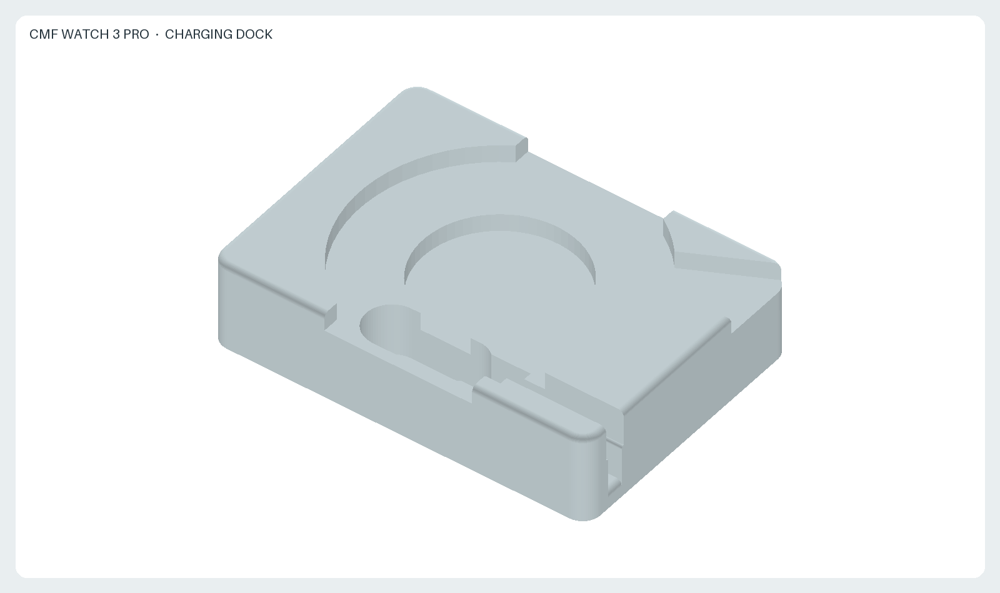
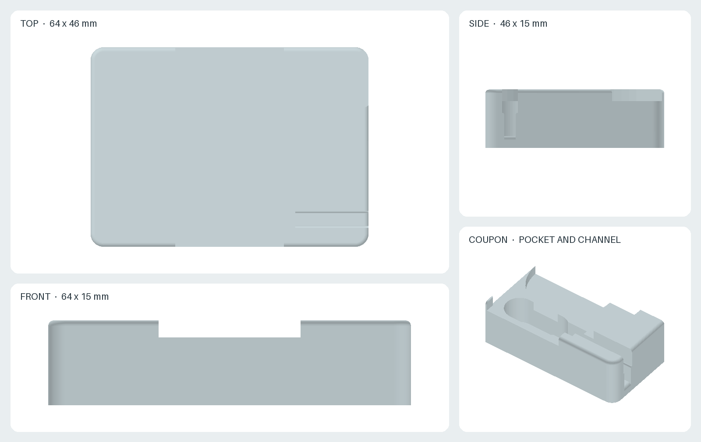
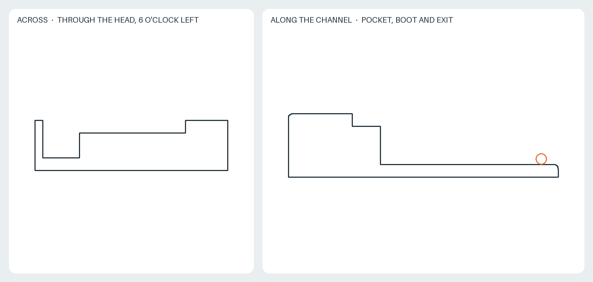
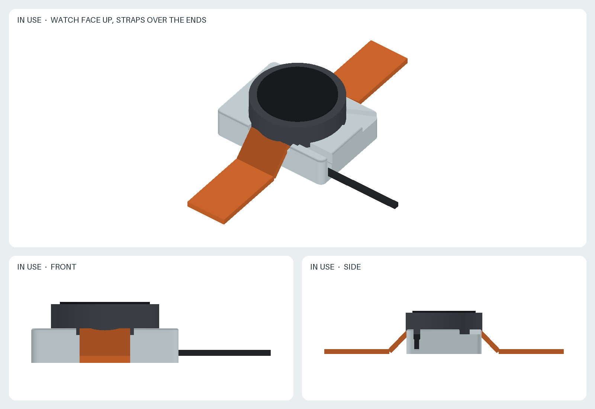

# CMF Watch 3 Pro 充電 dock

CMF Watch 3 Pro を文字盤を上にして机に平置きしたまま充電するための dock です。付属の充電ケーブルは先端の小さな磁気充電 head だけで時計を支える構造のため、時計を上向きに置くと head を支点に傾き、ケーブルに引かれて外れやすくなります。この dock は時計の裏面をセンサ部の外側の環状の座で受け、head を充電端子の真下の pocket に収め、ケーブルを溝に収めます。band は外さずに両端から垂らします。

状態: prototype。r1 を印刷して実機と比べた結果、裏面の充電端子位置とセンサ部の大きさが想定と異なっていたため、写真から縮尺を推定して r2 に修正しました。r2 の印刷では head が座面から約 4 mm 出て時計が乗り上げたため、r3 で pocket を深くし、竜頭の逃げを加えました。寸法は写真からの推定値です。実機を測って `generate.py` の parameter を更新し、`coupon.stl` で嵌合を確認してから `dock.stl` を印刷してください。

- [`dock.stl`](dock.stl): dock 本体、64 × 46 × 15 mm、一体、サポート不要。
- [`coupon.stl`](coupon.stl): pocket から溝の出口までを座の一部とともに切り出した 45 × 23 × 15 mm の嵌合確認用 coupon。dock の前に印刷して head の嵌合、ケーブル溝の幅、座に対する head の高さを確認します。
- [`generate.py`](generate.py): CadQuery の parametric source。単位は mm。
- [`render.py`](render.py): 画像の決定的な offline 生成。
- [`views.png`](views.png): 三面図と coupon。
- [`sections.png`](sections.png): head の中心を通る strap 方向の断面と、溝に沿った断面。
- [`preview.png`](preview.png): 斜視図。
- [`usage.png`](usage.png): 時計、band、充電 head、ケーブルの簡略化した stand-in を置いた使用状態。製品形状ではなく配置を示します。

## 構造

- **環状の座。** 上面に直径 47.5 mm、深さ 3 mm の円形の窪みがあり、その底面の半径 13 mm から外側が時計の裏蓋を受ける座です。座の内側は 3 mm 下げてあり、裏面中央のセンサ部 (直径約 24 mm) が当たりません。時計の荷重は head ではなく座にかかります。
- **head の pocket。** 裏面の充電端子は裏蓋の外周寄り、中心から 6 時側に約 16.7 mm の位置にあり、2 個の端子は 3 時-9 時方向に並びます。pocket は head の長辺をこの並びに合わせた長円形で、ケーブル側の端にケーブル根元の boot の逃げが続きます。pocket の底は head の上面が座面と同じ高さになる深さです。spring pin は head の housing より上に出るので、時計が座に乗った状態で pin が押し込まれ、接触圧が確保されます。
- **ケーブル溝。** boot の先から 3 時側の側面まで、幅 3.0 mm の上開きの溝がケーブルを座面より下に保持します。溝の幅はケーブルにちょうど合う値で、ケーブルは摩擦で留まります。r1 にあった返しは削除しました。
- **被覆の保護。** 溝の上縁は全長にわたり 0.5 mm で丸め、側面出口の床縁は 1 mm で丸めています。
- **band の逃げ。** 本体の奥行き 46 mm は時計の直径 47 mm より短く、12 時と 6 時の両端で lug が本体の外に出ます。さらに band の幅 (22 mm) に 3 mm を加えた範囲は、上面を座の高さまで下げてあり、band の付け根が本体に乗り上げません。band はそのまま両端から垂らします。
- **位置決め。** 座の壁は 3 時側と 9 時側に円弧として残り、時計の位置を決めます。壁の高さは 3 mm です。
- **竜頭の逃げ。** 竜頭は 3 時から 12 時側へ約 27 度の位置にあり、ケースから約 3.4 mm 出ています。この方向に幅 12 mm の範囲で壁を座の高さまで切り下げ、竜頭が壁に当たらないようにしています。幅は竜頭の直径約 6 mm に位置の推定誤差を加えた値です。

## 版ごとの変更

| 項目 | r1 | r2 | r3 |
| --- | --- | --- | --- |
| 充電端子の位置 `PAD_OFFSET` | 6 時側 7 mm | 6 時側 16.7 mm | 同左 |
| 座の内側の半径 `SEAT_INNER_RADIUS` | 19 mm | 13 mm | 同左 |
| センサ逃げの深さ `SENSOR_CLEARANCE` | 2 mm | 3 mm | 同左 |
| head の寸法 | 18 × 8 mm | 20 × 8.5 mm と boot 5 × 6.5 mm | 同左 |
| head の高さ `PUCK_HEIGHT` | 5 mm | 5 mm | 9 mm |
| ケーブルの返し | 3 か所 | なし | なし |
| 本体の奥行き `FOOT_Y` | 40 mm | 46 mm | 同左 |
| 本体の高さ `HEIGHT` | 14 mm | 14 mm | 15 mm |
| 本体の角の半径 `CORNER_RADIUS` | 6 mm | 3 mm | 同左 |
| band の逃げ | なし | 幅 25 mm を座の高さまで下げる | 同左 |
| 竜頭の逃げ | なし | なし | 2 時方向に幅 12 mm |

r1 では pocket がセンサ部の真下にあり、座面の高さに合わせた head がセンサ部に当たって時計が傾き、端子にも届きませんでした。r2 では pocket を端子の真下へ移し、座をセンサ部の外側の裏蓋で受ける形にしました。pocket が本体の 6 時側の縁に近づくため、本体の奥行きを広げ、側面の肉厚 (`MIN_WALL` 1.6 mm 以上) を `generate.py` で検査します。ケーブル出口が角の丸みにかからないよう角の半径を小さくしました。

r2 の印刷では head の上面が座面から約 4 mm 出て、時計が head に乗り上げました。真横から撮った写真で本体の高さ 14 mm を基準に測った値です。r3 では head の高さを 9 mm として pocket を深くし、pocket の底の厚さ (`MIN_FLOOR` 2.5 mm 以上) を確保するため本体を 1 mm 高くしました。あわせて竜頭の位置の壁を切り下げました。

## 推定値と実測項目

次の値は、r1 の dock (64 × 40 mm) と時計の直径 47 mm を基準に写真から縮尺を求めた推定値です。誤差は 1 mm 程度を見込んでください。実機で測った値に置き換えてください。

| Parameter | 推定値 | 測る対象 |
| --- | --- | --- |
| `PAD_OFFSET` | (0, -16.7) | 裏面の充電端子 2 個の中点の、裏面中心からの offset |
| `SEAT_INNER_RADIUS` | 13.0 | センサ部の半径 (約 12) に余裕を加えた値 |
| `SENSOR_CLEARANCE` | 3.0 | 裏蓋の平らな部分に対するセンサ部の出っ張りの高さに余裕を加えた値 |
| `PUCK_LENGTH` | 20.0 | head の長さ。boot を含めない |
| `PUCK_WIDTH` | 8.5 | head の幅 |
| `PUCK_HEIGHT` | 9.0 | head の housing の高さ。spring pin を含めない。r2 の印刷で座面から出た量から推定 |
| `BOOT_LENGTH` | 5.0 | ケーブル根元の boot の長さ |
| `BOOT_WIDTH` | 6.5 | boot の幅 |
| `CROWN_ANGLE` | 27.0 | 竜頭の中心の、3 時から 12 時側へ測った角度 |
| `CROWN_RELIEF` | 12.0 | 竜頭の逃げの幅。竜頭の直径に位置の誤差を加えた値 |
| `PUCK_ANGLE` | 0 | head を端子に付けたときにケーブルが出る向き。3 時側なら 0、9 時側なら 180 |

`CABLE_DIAMETER` 2.6 と `CABLE_CLEARANCE` 0.4 による溝幅 3.0 mm は、r1 の印刷でケーブルにちょうど合うことを確認済みです。公開値から取った値は `CASE_DIAMETER` 47.0、`CASE_THICKNESS` 14.4、`STRAP_WIDTH` 22.0 です。

## 実測後の手順

1. head、ケーブル、時計裏面を測り、`generate.py` の parameter を更新する。
2. リポジトリの README の手順で `generate.py` と `render.py` を実行する。`generate.py` は pocket の底の厚さ、pocket と本体側面の肉厚、サポートが必要な面の有無を検査し、問題があれば停止する。
3. `coupon.stl` を印刷し、head が pocket に入ること、ケーブルが溝に収まること、head の上面が座面と同じ高さになることを確認する。head が低ければ `PUCK_PROUD` を正に、高ければ負にして再生成する。pocket が固ければ `PUCK_CLEARANCE` を増やす。
4. `dock.stl` を印刷し、時計を置いて充電表示が出ること、時計が傾かないこと、ケーブルを軽く引いても head が外れないことを確認する。

## 印刷

上面の窪みと溝はすべて上から切り込んだ形状で、底面は平面です。そのまま底面を bed に置いて印刷し、サポートは不要です。`generate.py` は 45 度より急な下向きの面がないことを検査します。材料は PLA または PETG で、中実換算で約 42 g です。座面の高さ精度が head との高さ関係に直接影響するため、最初の層の潰れ量を考慮して coupon で確認してください。

## 出典と前提

- [GSMArena: CMF Watch 3 Pro launches](https://www.gsmarena.com/cmf_watch_3_pro_launches_with_bigger_143_screen_longer_battery_life_and_higher_price_tag-news-68721.php): **47 × 47 × 14.4 mm**、**22 mm** の着脱式 strap。
- [Nothing Support: Is the charging cable for Watch 3 Pro compatible with that of Watch Pro 2?](https://support.nothing.tech/hc/en-us/articles/37210046739729-Is-the-charging-cable-for-Watch-3-Pro-compatible-with-that-of-Watch-Pro-2): Watch 3 Pro のケーブルは Watch Pro / Pro 2 と非互換。head の寸法は旧機種用の資料から転用せず、実測します。
- [TechRadar](https://www.techradar.com/health-fitness/smartwatches/cmf-watch-3-pro-review)、[Wareable](https://www.wareable.com/smartwatches/cmf-watch-3-pro-review)、[Android Police](https://www.androidpolice.com/i-tried-nothing-cmf-watch-pro-3-disappointed/) のレビュー: 充電 head の磁力が弱く、わずかな衝撃で外れる。

次の値は写真からの推定または設計上の選択で、実測では確認していません。

- 充電端子の位置、センサ部の直径、head と boot の寸法は、r1 の dock と時計を並べて真上から撮った写真から縮尺を求めて推定しています。
- 写真で時計の裏側から見て竜頭が右にあることから、端子のある側を 6 時側と判断しています。
- head の高さ 9 mm は、r2 の印刷で head が座面から出た量 (約 4 mm) を写真から測り、r2 の pocket の深さ 5 mm に加えた推定値です。
- 竜頭の位置と寸法は、時計を裏返して真上から撮った写真から推定しています。

STL は Python 3.12 と CadQuery 2.7.0 で生成し、画像は NumPy 2.3.5 と Pillow 12.3.0 で描画しています。再生成と検証は[リポジトリの README](../README.md) の Nix と container の手順に従ってください。

License: [CC BY-SA 4.0](../LICENSE.md)。本 design は独立した accessory であり、Nothing Technology の公式製品ではありません。CMF と Nothing は各権利者の商標であり、対応機種を示す目的でのみ使用しています。
