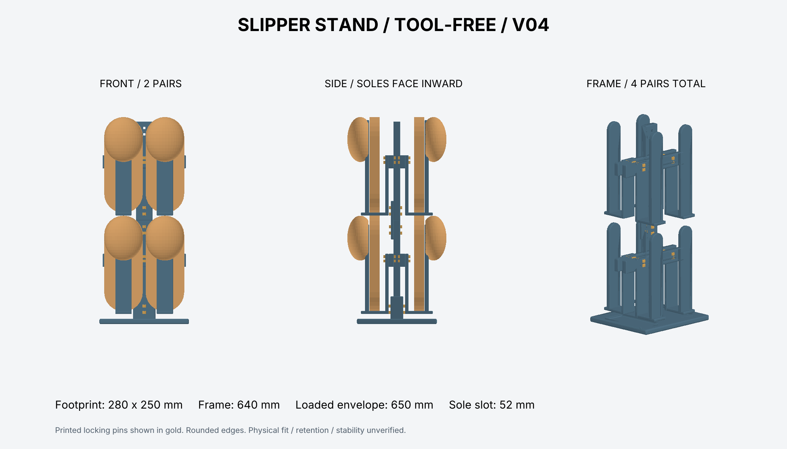
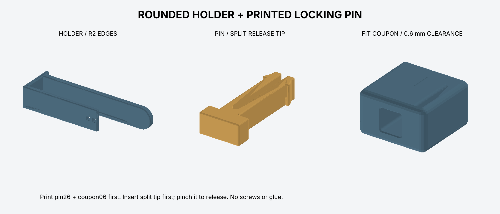

# スリッパスタンド試作 v0.4

前後各2足・上下2段で、成人用4足を収納。靴底は中央向き、甲は外側向き。
印刷した抜け止めピンで組み立てる。ねじ・ナット・接着剤は使用しない。
露出する部品の角とスリッパに触れる縁を丸めた試作モデル。

v0.4では支持具の靴底用の溝を22 mmから52 mmへ広げた。変更部品はholder.stlのみで、
v0.3で印刷済みのベース・支柱・継ぎ板・横桟・ピンはそのまま使用する。

最初にpin26.stlとcoupon06.stlを各1個印刷し、差し込みと抜け止めを確認する。
部品数・組立・検証範囲は [docs/prototype.md](docs/prototype.md) を参照。

`python slipper-stand/scripts/build.py`：STL生成・検査。
`python slipper-stand/scripts/render.py`：実際のSTLから確認画像を出力。
`python slipper-stand/scripts/package.py`：配布ZIPを生成。

実印刷、実物スリッパへの適合、保持力、強度、転倒安定性は未検証。

## 印刷ファイルと個数

印刷用STLは [output/](output/) にあります。単位はmmです。

| ファイル | 個数 |
| --- | ---: |
| [base.stl](output/base.stl) | 1 |
| [mast.stl](output/mast.stl) | 2 |
| [splice.stl](output/splice.stl) | 1 |
| [rail.stl](output/rail.stl) | 4 |
| [holder.stl](output/holder.stl) | 8 |
| [pin26.stl](output/pin26.stl) | 16 |
| [pin28.stl](output/pin28.stl) | 4 |
| [pin40.stl](output/pin40.stl) | 2 |
| [pin52.stl](output/pin52.stl) | 4 |

合計42個。別途coupon06.stlを1個、必要ならcoupon04/coupon08を印刷して比較します。
テストしたpin26が使用可能なら16個に含められます。
生成されるassembly/frame/hardware/shoes.stlは表示確認用で、印刷不要です。




## 検証と再生成

リポジトリのルートで `python slipper-stand/scripts/check.py` を実行すると、
保存済みSTLの閉鎖性・単一連結・寸法・底面位置・体積と、validation.jsonの記録を検査します。
この検査は既存の全体チェックにも組み込まれています。
OpenSCADモデルの再生成は上記build.pyで別途実行します。
render.pyはbuild.pyが生成する確認用シーンも必要です。

収録STLはOpenSCAD 2021.01で生成したv0.4のスナップショットです。
CIでの検査は保存済みメッシュの検査であり、OpenSCADによる再生成や
PNGのバイト一致を確認するものではありません。再生成にはOpenSCADが別途必要です。
既存のNix環境にOpenSCADは含まれていないため、flake.nixと同じnixpkgsリビジョンから取得します。

```sh
nix build --no-link --print-out-paths \
  'git+https://github.com/NixOS/nixpkgs?rev=597283ad8aa0b331c788e97c4c262d58877074ef&shallow=1#openscad'
```

出力されたストアパスの`bin`を`PATH`へ加えてbuild.pyを実行します。
v0.4ではholderのみを`--parts holder`で再生成しました。
v0.3から変更していない部品は、同じ環境で再生成すると面の順序だけが異なる同一形状となるため、保存済みSTLを維持しています。

[CC BY-SA 4.0](../LICENSE.md) / Copyright © 2026 sabas0ba.
