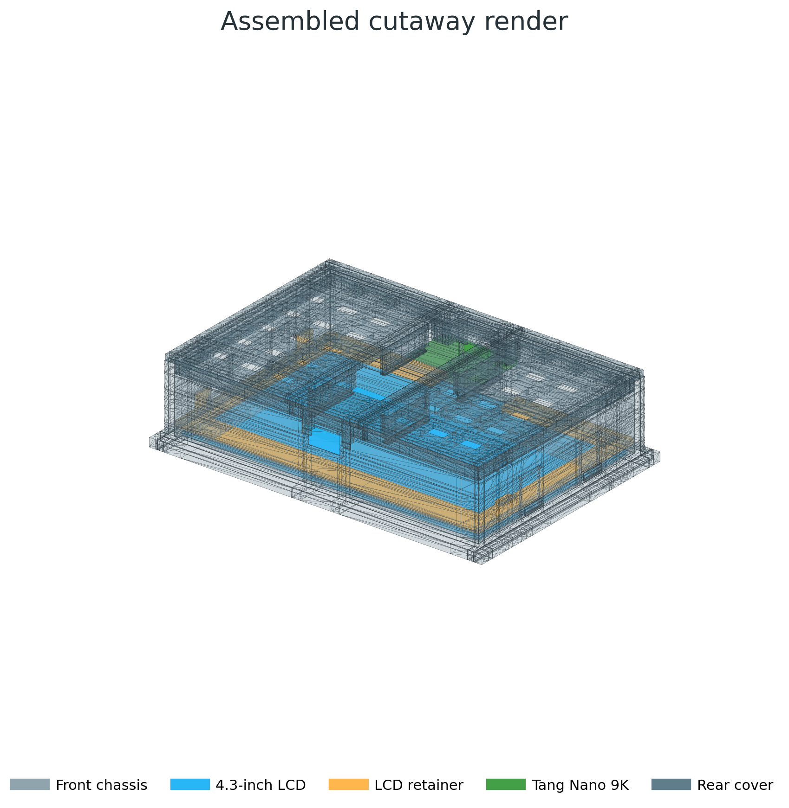
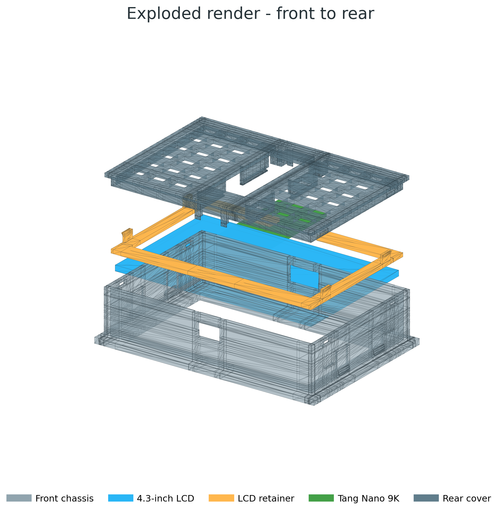
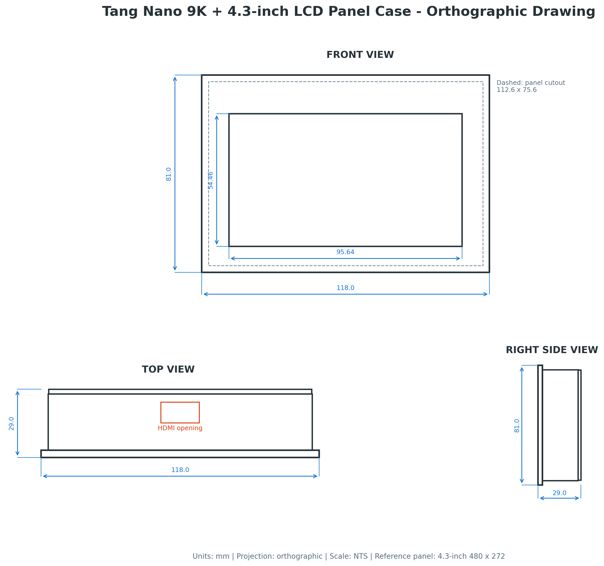

# Tang Nano 9K + RGB LCD panel case

Tang Nano 9KとSipeedが推奨する40ピンRGB LCDを既設パネルへ組み込むための3Dプリントケースです。外部からUSB-C、HDMI、microSDへアクセスできます。LCDごとに設計プロファイルを持ち、4.3インチ480×272と5インチ800×480の2種類に対応します。





## LCDプロファイル

| 項目 | 4.3インチ（`4p3in`） | 5インチ（`5p0in`） |
| --- | --- | --- |
| LCD | HT043DA-V.0、480×272 | SH500J01Z、800×480 |
| LCD外形 | 105.50 × 67.15 × 2.90 mm | 120.70 × 75.90 × 3.05 mm |
| LCD表示領域 | 95.04 × 53.856 mm | 108.00 × 64.80 mm |
| FPCの向き | ケース上側（HDMI側） | ケース下側（USB-C側） |
| 前面ベゼル | 118.00 × 81.00 mm | 131.80 × 87.00 mm |
| 本体外形 | 112.00 × 75.00 mm | 125.80 × 81.00 mm |
| パネル角穴の初期値 | 112.60 × 75.60 mm | 126.40 × 81.60 mm |
| 表示窓 | 95.64 × 54.456 mm | 108.60 × 65.40 mm |
| LCD外周と壁内面の隙間（片側） | 左右1.25 mm、上下1.93 mm | 0.55 mm |
| 基板端と上下壁内面の距離 | 0.50 mm | 3.50 mm |
| USB-C開口 / HDMI開口 | 12.4 × 7.4 / 16.4 × 8.8 mm | 15.0 × 9.0 / 23.0 × 12.0 mm |
| 基板の長手方向固定 | リアカバーの端部ストッパー | リアカバーのコネクタ隔壁 |

手元のLCDがどちらか不明な場合は、外形を測定してください。約105.5 × 67.2 mmなら`4p3in`、約120.7 × 75.9 mmなら`5p0in`です。原寸PDFの4ページにあるLCD型紙を100%で印刷し、実物を重ねて確認することもできます。

両プロファイルに共通の寸法は次のとおりです。

- Tang Nano 9K PCB: `70.00 × 26.00 × 1.60 mm`
- Tang Nano 9K取付穴: HDMI側の2穴、中心間隔`20.80 mm`
- 標準版全奥行き: `29.0 mm`（シャーシ27.0 mm、背面板2.0 mm）
- 20 mm増設空間版の全奥行き: `42.0 mm`
- 30 mm増設空間版の全奥行き: `52.0 mm`
- 表示窓: 表示領域に対して全周0.3 mm拡大

### 5インチ版のコネクタ隔壁

5インチ版はLCDの外形で本体の高さが決まるため、Tang Nano 9Kの両端からシャーシ上下壁まで3.5 mmの距離があります。LCDを背面から挿入する構造上、シャーシ内側へ壁を張り出すことはできません。そのため、リアカバーに基板端から0.30 mmの位置で厚さ2.0 mmの隔壁を設けています。これは4.3インチ版の上下壁と同じ位置関係です。隔壁はLCD側へ開いたU字形の切欠きを持ち、基板を押し込む際にコネクタが通過できます。隔壁の内面は基板端部ストッパーを兼ねます。

シャーシ上下壁の開口は、ケーブルのモールド部が隔壁の面まで入る大きさです。使用できるケーブルのモールド外形は、USB-Cが15.0 × 9.0 mm以下、HDMIが23.0 × 12.0 mm以下です。

## 収録STL

STLは[`stl/4p3in/`](stl/4p3in/)と[`stl/5p0in/`](stl/5p0in/)にあります。両プロファイルのファイル名は共通で、単位はmmです。

| ファイル | 用途 |
| --- | --- |
| `front_chassis_panel_1p5mm.stl` | 厚さ1.5 mmパネル用の前面シャーシ |
| `front_chassis_panel_2p0mm.stl` | 厚さ2.0 mmパネル用の前面シャーシ |
| `front_chassis_panel_3p0mm.stl` | 厚さ3.0 mmパネル用の前面シャーシ |
| `lcd_retainer.stl` | LCD背面の押さえ枠 |
| `rear_cover.stl` | Tang Nano 9K保持レール付き背面カバー |
| `rear_cover_clearance_20mm.stl` | 基板背面から20 mmの増設空間を持つ背面カバー |
| `rear_cover_clearance_30mm.stl` | 基板背面から30 mmの増設空間を持つ背面カバー |
| `assembly_reference_clearance_20mm.stl` | 20 mm版の組立状態確認用。印刷禁止 |
| `assembly_reference_clearance_30mm.stl` | 30 mm版の組立状態確認用。印刷禁止 |

`assembly_reference_*.stl`は、フロントシャーシ、LCD外形、LCDリテーナー、PCB外形、リアカバーを組立座標へ配置した複数シェルの参照モデルです。部品間には意図的な接触とスナップ掛かりがあるため、単一部品としてスライスまたは印刷しないでください。

## レンダリング・図面

[`output/4p3in/`](output/4p3in/)と[`output/5p0in/`](output/5p0in/)に、プロファイルごとに次のファイルがあります。

| ファイル | 内容 |
| --- | --- |
| `images/assembly_render.png` | 内部構成を示す半透明組立レンダリング |
| `images/exploded_render.png` | 前面から背面への分解レンダリング |
| `images/orthographic_three_view.png` | 前面・上面・右側面の三面図 |
| `pdf/tang-nano-9k-panel-case-drawing.pdf` | 三面図、レンダリング、主要寸法をまとめたPDF |
| `pdf/tang-nano-9k-panel-case-1to1.pdf` | A4横・原寸1:1の部品、実機照合、組立断面図（100 mm校正線付き） |
| `pdf/tang-nano-9k-panel-case-retention-design.pdf` | スナップ固定、荷重経路、組立・分解方法の図解設計書 |

固定構造、公差、検証項目は[`docs/retention-design.md`](docs/retention-design.md)に記載しています。

原寸PDFの5〜10ページと固定設計PDFの6〜10ページには、STLと同じCSG形状から生成したA-A〜E-E断面を収録しています。塗りつぶし形状は印刷モデルの正確な断面、橙色破線は実基板で確認が必要なコネクタ・実装部品エンベロープです。

原寸図を印刷する際は「実際のサイズ / 100%」を選び、「ページに合わせる」を無効にしてください。印刷後、各ページの100 mm校正線を定規で確認します。

## 組立

1. 使用するパネル厚に対応した前面シャーシを、パネル前面から角穴へ挿入します。
2. LCDを表示面が前面窓側になる向きで置きます。FPCの向きはプロファイルの表に従います。4.3インチのHT043DA-V.0は、表示領域がFPC側の縁から9.25 mm、反対側の縁から4.04 mmの位置にあります。5インチのSH500J01Zは、FPC側の縁から7.76 mm、反対側の縁から3.34 mmの位置にあります。
3. `lcd_retainer.stl`のFPC切欠きをFPC側へ合わせ、左右4本のフックがシャーシ受け穴へ掛かるまで押し込みます。リアカバーなしでリテーナーが外れないことを確認します。
4. Tang Nano 9Kの左長辺を背面カバーの固定リップ下へ差し込み、右長辺を2本の弾性爪へ押し込みます。部品面をLCD側、microSDソケット面を背面カバー側へ向けます。
5. 基板両端が、USB-C側とHDMI側の端部ストッパー（5インチ版はコネクタ隔壁）の間に入っていることを確認します。
6. 必要に応じて、HDMI側2穴をM2x8セルフタッピングねじでボスへ固定します。スナップのみで使用する場合、このねじは不要です。
7. FPCを接続し、USB-C側をケース下側、HDMI側を上側に合わせて背面カバーを押し込みます。背面板がシャーシ後端に当たり、4か所のラッチが掛かります。

2.54 mmピンヘッダを実装した基板は、背面カバーの保持レールと干渉する可能性があります。設計は未実装基板を基準にしています。

背面カバーの左右非荷重領域には、材料使用量を抑えるため8.0 × 6.0 mmの貫通スロットを格子状に配置しています。外周リム、PCB保持レール、M2ボスおよび端部ストッパーの周囲はソリッドのままです。スライサーで内部充填を指定できる場合も、保持部周辺の強度を下げないでください。

## 推奨印刷条件

- 材料: PETG推奨。PLAを使う場合はスナップ爪の繰返し着脱を避ける
- ノズル: 0.4 mm
- 積層: 0.20 mm
- 外周: 4周
- 充填: 25%以上
- 前面シャーシ: ベゼル面をビルドプレートへ向ける
- LCD押さえ・背面カバー: 平板面をビルドプレートへ向ける
- サポート: 原則不要。ブリッジ設定を有効化

最初にパネル角穴を小さめに加工し、現物合わせで片側0.1 mmずつ拡張してください。LCDへ局所的な荷重を掛けないよう、押さえ枠が強く嵌る場合は外周を研磨します。

## 再生成と検証

生成環境はリポジトリ直下のflake、`pyproject.toml`、`uv.lock`で固定しています。手順は[リポジトリのREADME](../README.md)を参照してください。`scripts/generate_all.py`が`generate.py`と`render.py`を実行し、`--check`を付けるとSTL、PNG、PDFをコミット済みのファイルとバイト単位で比較します。

この設計だけを再生成してテストする場合は、リポジトリ直下で次を実行します。

```sh
nix develop --command .venv/bin/python tang-nano-9k-lcd-case/generate.py
nix develop --command .venv/bin/python tang-nano-9k-lcd-case/render.py
nix develop --command .venv/bin/python -m unittest discover -s tang-nano-9k-lcd-case/tests
```

`generate.py`は[`tools/generate_stl.py`](tools/generate_stl.py)の形状定義から`stl/<profile>/`へSTLを書き出します。形状生成はPython標準ライブラリだけを使用します。`render.py`はMatplotlibとReportLabで`output/<profile>/`のPNGとPDFを生成します。PDFのフォントは、flakeが`DEJAVU_FONT_PATH`で指定するDejaVu Sansです。

LCDプロファイルの構成と追加手順は[`docs/development.md`](docs/development.md)に記載しています。

テストは全プロファイルの全STLについて、次の項目を確認します。

- バイナリ形式、境界寸法、有限座標、正の体積
- 全エッジがちょうど2面に共有される閉じた2-manifoldメッシュであり、単一の連結成分だけを持つこと
- 組立状態の全部品の組合せで体積干渉がないこと。許容するのはラッチ爪の0.05 mmの当たり代だけ
- B-Bが基板固定リップと弾性爪、C-CがLCDフックと受け穴、D-DがmicroSD開口、E-EがHDMI側2本のM2ボスを実際に通過すること
- ラッチ爪が受け穴内にあり、背面板または当たり柱がシャーシ後端に接すること
- 5インチ版のコネクタ隔壁が基板端から0.30 mmにあり、切欠きとモールド通過領域が開いていること
- 原寸PDFと固定設計PDFの全描画要素が図枠内にあり、校正線と注記に重ならないこと

## 出典と前提

- [Sipeed Tang Nano 9K公式ページ](https://wiki.sipeed.com/hardware/en/tang/Tang-Nano-9K/Nano-9K.html): HDMI、RGB LCD、SPI LCD、TFカード、USB-C、5インチRGB LCDの案内
- [Sipeed Tang Nano 9K公式寸法図](https://dl.sipeed.com/fileList/TANG/Nano%209K/4_Dimensional_drawing/Tang_Nano_9K_3672_size.pdf): PCB `70.0 × 26.0 mm`
- [Sipeed配布LCD資料 HT043DA-V.0](https://dl.sipeed.com/Accessories/LCD/HT043DA-V.0-%E5%8D%95%E5%B1%8F%E6%9B%B4%E6%96%B0%E7%89%88%E6%9C%AC.pdf): 4.3インチの外形、表示領域、FPC位置（p.5 Dimensional Drawing）。照合時のSHA-256は`a2c215186a55824efd8c7bf994802d420560ae016ec5b4f1875d34e168c23e0b`
- [Sipeed配布LCD資料 5.0inch_LCD_Datashet _RGB_](https://dl.sipeed.com/fileList/TANG/Nano%209K/6_Chip_Manual/EN/LCD_Datasheet/5.0inch_LCD_Datashet%20_RGB_.pdf): 5インチSH500J01Z Rev 00の外形、表示領域、FPC位置（p.4 Outline Drawing）。照合時のSHA-256は`8c1d0d021e24517e8d638ad035dada02e86c206da4f1ef5e732bae84d09aa4b6`

1.14インチSPI LCDおよび7インチLCDには対応しません。データシートは発行時点の版であり、流通品のロット差があり得ます。印刷前にLCD外形とFPC位置を実測し、Tang Nano 9Kのコネクタ高さとFPCの取り回しを実機で確認してください。

## 由来

この設計は[sabas0ba/tang_nano_9k_case](https://github.com/sabas0ba/tang_nano_9k_case)のcommit `2af27d0537e62a43d47cf844c9ad776968ca6043`から取り込みました。形状定義、図面生成、テストは同じです。生成環境、CI、成果物の配布方法は本リポジトリのものへ置き換えています。
