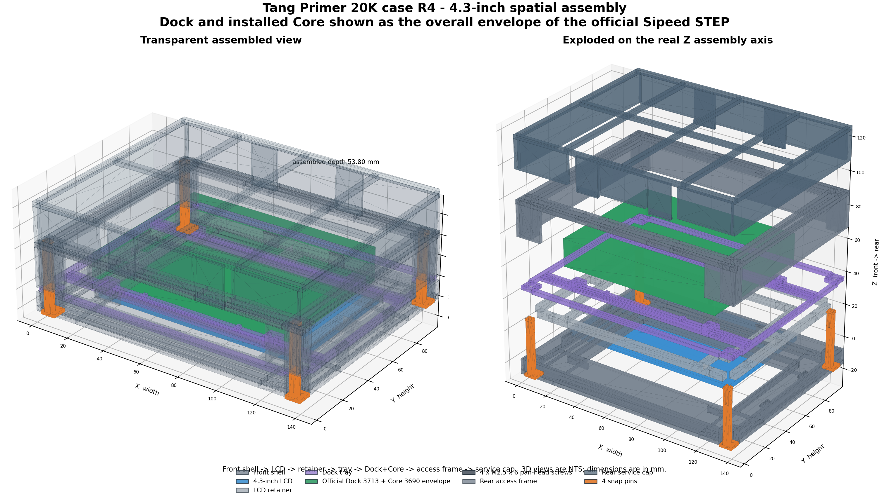
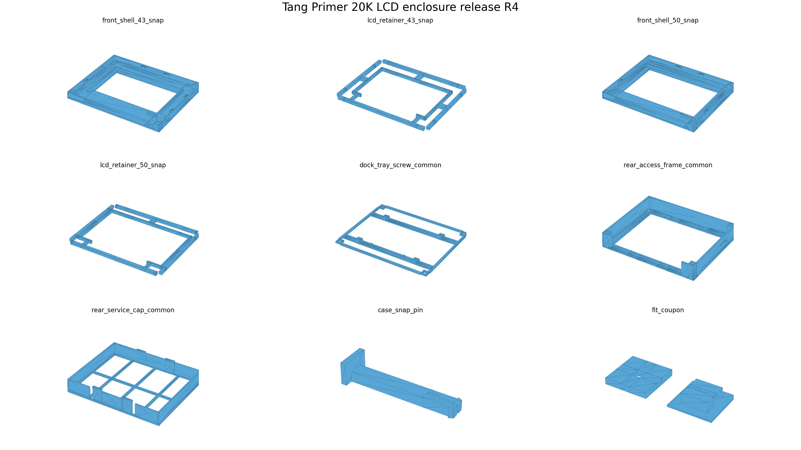

# Tang Primer 20K Dock + 4.3/5.0-inch LCD case R4

Tang Primer 20K Core装着済み公式Dockと、公式4.3インチまたは5.0インチRGB LCDを一体化するFDMケースです。現行バージョンはv1.0.2です。R4は外形を140.00 x 112.00 x 53.80 mmへ拡張し、固定されたリアアクセスフレームと、工具なしで着脱できる20 mmサービスキャップを追加しました。




## 成果物

STLは[`stl/`](stl/)、図面・設計仕様・参照モデル・検証レポートは[`output/`](output/)にあります。単位はmmです。旧R3の図面・STLは含めません。

| ファイル | 数量 | 用途 |
|---|---:|---|
| `front_shell_43_snap.stl` / `front_shell_50_snap.stl` | どちらか1 | LCD別フロント |
| `lcd_retainer_43_snap.stl` / `lcd_retainer_50_snap.stl` | 対応品1 | LCD押さえ |
| `dock_tray_screw_common.stl` | 1 | Dock四隅ねじ固定 |
| `rear_access_frame_common.stl` | 1 | 外装保持と120 x 92 mmサービス開口 |
| `rear_service_cap_common.stl` | 1 | 着脱式20 mm背面空間、PMOD配線出口 |
| `case_snap_pin.stl` | 4 | 前面から固定フレームまでのねじレス固定 |
| `fit_coupon.stl` | 1 | 造形機別の嵌合確認 |
| `Tang_Primer_20K_Case_R4_Complete_Assembly_43.stl` | 1 | 4.3インチ完成組立・Viewer専用 |
| `Tang_Primer_20K_Case_R4_Complete_Assembly_50.stl` | 1 | 5.0インチ完成組立・Viewer専用 |
| `Tang_Primer_20K_Case_R4_Drawings_1to1.pdf` | 1 | 正式A3図面、13ページ |
| `Tang_Primer_20K_Case_R4_Design_Specification.pdf` | 1 | 設計・組立・サービス仕様 |

完成組立STLと色分け3MF（`output/Tang_Primer_20K_Case_R4_Reference_Assembly_43.3mf` / `_50.3mf`）は、DockとCoreの外形、LCD、M2.5ねじ、全印刷部品を組立位置に配置しています。重複閉メッシュを含むためスライスせず、格納位置の確認だけに使用してください。FPCは実物ごとに曲げ形状が変わるため含めていません。

### DockとCoreの表現

Sipeedが配布するDock/CoreのSTEPと、そこから変換したメッシュは、本リポジトリに含めていません。完成組立STL、3MF、組立レンダリング、図面の断面では、Core装着済みDockを公式STEPの外形境界（98.18 x 76.39 x 16.75 mm）の直方体で表しています。コネクタや部品の個別形状は描かれません。印刷部品の形状と、Dock穴ピッチ、PCB厚、背面すきまなどの寸法は、公式STEPから測定した値をそのまま使用しています。

手元に公式STEPから変換したバイナリSTLがある場合は、`generate_assembled_stl_r4.py`、`generate_reference_3mf_r4.py`、`generate_release_drawings.py`、`render_spatial_assembly_r4.py`の`--dock-step-stl`に指定すると、実形状で生成できます。

## 背面アクセス

- 固定フレームの外面はZ=33.80 mm。従来の37.00 mmケースピンを長くせず、そのまま使用します。
- サービスキャップがZ方向へ20.00 mm追加され、内面はZ=51.40 mm、外面はZ=53.80 mmです。
- 公式Dock+Core STEP最大Z=30.165 mmとの公称余裕は21.235 mmです。
- キャップは上フック2本を先に挿入し、下プッシュタブ2本をクリックさせます。
- 取り外しは下タブ2本を内側へ押し、下辺を起こして上フックを抜きます。ケースピンやDockねじは外しません。
- 下辺に幅20.00 mmの開放切欠きが2か所あり、PMODケーブルを接続したまま着脱できます。

## 固定仕様

- Dock: 公式87.00 x 65.00 mmピッチの四隅穴、M2.5 x 6なべ頭ねじ4本。
- トレイ下穴: 2.00 mm角、深さ4.80 mm、底残り0.80 mm。
- LCD: 外形ポケット、LCDリテーナー、6本のカンチレバー爪。
- Core: DockのSODIMM接点と両側ラッチ。
- FPC: 開放ガイド、コネクタロック、薄手ポリイミドテープ。
- 外装構造: プリント製分割スナップピン4本。
- サービスキャップ: 上フック2本、下プッシュタブ2本。

詳細寸法、組立・分解手順、合格基準は`DESIGN_R4.md`を参照してください。

## 造形

- 材料: PETG推奨
- ノズル: 0.4 mm
- 積層: 0.20 mm以下。サービスキャップのタブは0.16 mm推奨
- 外周: 4周以上。タブは5周推奨
- インフィル: 20～30%、スナップピン100%
- サポート: 不要

STLは納品姿勢のまま造形します。リアアクセスフレームは開口フランジ、サービスキャップは背面格子をベッドへ向けます。係止突起は印刷方向に傾斜成長し、水平な空中開始面を持ちません。

## 再生成と検証

生成環境はリポジトリ直下のflake、`pyproject.toml`、`uv.lock`で固定しています。手順は[リポジトリのREADME](../README.md)を参照してください。`scripts/generate_all.py`が`generate.py`と`render.py`を実行し、`--check`を付けるとSTL、PNG、PDF、3MF、JSONをコミット済みのファイルとバイト単位で比較します。

この設計だけを再生成してテストする場合は、リポジトリ直下で次を実行します。

```sh
nix develop --command .venv/bin/python tang-primer-20k-lcd-case/generate.py
nix develop --command .venv/bin/python tang-primer-20k-lcd-case/render.py
nix develop --command .venv/bin/python -m unittest discover -s tang-primer-20k-lcd-case/tests
```

`generate.py`は印刷用STL、`stl/manifest.json`、完成組立STLを`stl/`へ書き出します。形状生成はPython標準ライブラリだけを使用します。`render.py`はMatplotlibとReportLabで`output/`のPNG、PDF、3MFを生成し、`verify_release.py`の検証結果を`output/verification_report.json`へ書き出します。検証結果がFAILの場合は終了コード1で停止します。

図面は納品STLから直接三面図を投影し、組立断面は納品STLとDock外形の直方体を交差させて生成します。1:1図面はA3用紙へ100%で印刷し、用紙合わせを無効にしてください。

初回は`fit_coupon.stl`、ケースピン1本、`rear_service_cap_common.stl`を先に造形し、穴補正、タブの係止力と指での解除を確認してください。落下、車載、長期振動、防水、安全規格は未評価です。

## 由来

この設計は[sabas0ba/tang_primer_20k_case](https://github.com/sabas0ba/tang_primer_20k_case)のcommit `9c9b73ae1fb763cf07efadfae853230ef7e7d9c9`（v1.0.2）から取り込みました。印刷部品の形状定義とテストは同じです。次の点を変更しています。

- Sipeedの公式STEPから変換したDock参照メッシュを含めず、外形境界の直方体で代替した
- 生成環境、CI、成果物の配布方法を本リポジトリのものへ置き換えた
- 3MFとPDFから生成時刻を除き、バイト単位で再現できるようにした
- ライセンスをApache-2.0からCC BY-SA 4.0へ変更した
